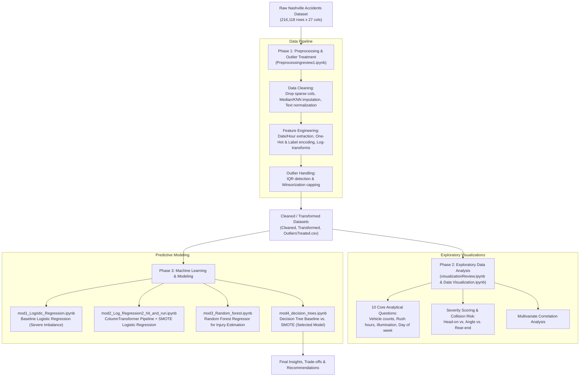

# 🚗 Driving into Data: Predictive Analysis & Classification of Nashville Traffic Incidents

[-blue.svg)](https://www.kaggle.com/datasets/justinwilcher/nashville-accident-reports-jan-2018-apl-2025)
[](#domain-understanding--sdg-alignment)
[-success.svg)](#project-overview)
[](#repository-notebooks--workflow)

---

## 📌 Project Overview

Urban centers experience rising vehicle densities, escalating traffic congestion, and severe road safety challenges. According to the World Health Organization (WHO), traffic accidents constitute the 8th leading cause of death globally, claiming over 1.35 million lives every year. 

This project presents an end-to-end data science study analyzing **216,118 traffic accident records in Nashville, Tennessee** spanning from **January 2018 to April 2025**. By combining rigorous data preprocessing, exploratory data analysis (EDA), and machine learning models, the project isolates key factors driving collision frequencies and injury severities, identifies accident hotspots and high-risk conditions, and develops predictive classification models for rare, critical events such as **Hit-and-Run collisions**.

### 🎯 Primary Objectives
1. **Analyze Temporal & Spatial Patterns:** Uncover recurring traffic collision trends across hours of the day, weekdays, illumination levels, and weather conditions.
2. **Evaluate Severity Drivers:** Quantify collision severity across collision types (e.g., head-on vs. rear-end) and environmental conditions.
3. **Hit-and-Run Predictive Modeling:** Address severe class imbalances to identify and predict hit-and-run incidents using supervised learning algorithms (Logistic Regression, Decision Trees with SMOTE).
4. **Injury Count Estimation:** Model the expected number of injuries using ensemble regression techniques (Random Forest Regressor).
5. **Actionable Policy Recommendations:** Provide data-driven insights to assist transportation authorities, city planners, and law enforcement in optimizing road infrastructure and emergency response allocation.

---

## 🌐 Domain Understanding & SDG Alignment

This project directly aligns with the **United Nations Sustainable Development Goals (SDGs)**:

| SDG | Target | Project Contribution |
| :--- | :--- | :--- |
| **SDG 3: Good Health and Well-Being** | **Target 3.6:** Halve global road traffic deaths and injuries | Pinpointing dangerous crash types (e.g., head-on collisions) to recommend life-saving median barriers and traffic calming measures. |
| **SDG 9: Industry, Innovation, and Infrastructure** | **Target 9.1:** Develop quality, reliable, and resilient infrastructure | Mapping high-risk intersections and lighting deficits to direct civic engineering improvements. |
| **SDG 11: Sustainable Cities and Communities** | **Target 11.2:** Safe, accessible, and sustainable transport systems | Assisting urban mobility management through rush-hour patrol scheduling and intersection signal timing. |

---

## 📊 Dataset Description

The analysis is conducted on the official **Nashville Accident Reports (Jan 2018 – Apr 2025)** dataset sourced from Kaggle:
- **Total Records:** 216,118 rows
- **Total Features:** 27 columns
- **Attribute Categories:**
  - **Incident Identifiers:** `Accident Number`, `Date and Time`
  - **Impact & Severity:** `Number of Motor Vehicles`, `Number of Injuries`, `Number of Fatalities`, `Property Damage (Y/N)`, `Hit and Run (Y/N)`
  - **Collision & Environmental Attributes:** `Collision Type Description`, `Collision Type`, `Weather Description`, `Weather`, `Illumination Description`, `Illumination`
  - **Geographic & Spatial Data:** `Street Address`, `City`, `State`, `Zip Code`, `Precinct`, `Lat`, `Long`, GIS coordinates (`x`, `y`)
  - **Administrative Metadata:** `HarmfulCodes`, `HarmfulDescriptions`, `ObjectId`, `RPA`, `Reporting Officer`

---

## 🔄 End-to-End Project Workflow

The project is structured into three progressive phases: Data Preprocessing & Outlier Treatment, Exploratory Visualizations, and Model Building & Imbalance Resolution.



---

## 📁 Repository Notebooks & Detailed Flow

The repository contains seven core Jupyter Notebooks, each serving a distinct role in the project lifecycle:

```
├── Preprocessingreview1.ipynb            # Phase 1: Cleaning, transformation & Winsorization
├── visualizationReview.ipynb            # Phase 2A: Comprehensive 10-question EDA review
├── Data Visualization.ipynb              # Phase 2B: Presentation-focused severity analysis
├── mod1_Logistic_Regression.ipynb       # Phase 3A: Baseline Hit-and-Run classification
├── mod2_Log_Regression2_hit_and_run.ipynb # Phase 3B: SMOTE + Scaled Logistic Regression pipeline
├── mod3_Random_forest.ipynb              # Phase 3C: Injury regression via Random Forest
└── mod4_decision_trees.ipynb            # Phase 3D: Decision Tree baseline vs. SMOTE optimization
```

---

### 1. [`Preprocessingreview1.ipynb`](./Preprocessingreview1.ipynb)
**Purpose:** Comprehensive data preparation pipeline transforming noisy raw accident records into modeling-ready datasets.
- **Data Cleaning:**
  - Evaluates missingness per feature; removes columns exceeding a 70% missingness threshold.
  - Imputes missing numerical coordinates and counts using median and K-Nearest Neighbors (`KNNImputer(n_neighbors=5)`).
  - Categorical missing values (e.g., `Weather Description`) are filled via mode imputation.
  - Drops duplicate records based on composite unique keys: `['Date and Time', 'Street Address', 'Number of Motor Vehicles']`.
  - Normalizes string fields (lowercasing, whitespace trimming, standardizing boolean flags `y`/`n`).
- **Feature Engineering & Transformation:**
  - Parses timestamp into datetime objects and extracts temporal components: `Date`, `Time`, `Year`, `Month`, `Day`, `Hour`, and `Day_of_week`.
  - Applies **Min-Max Scaling** (`MinMaxScaler`) to continuous numerical variables: `Number of Motor Vehicles`, `Number of Injuries`, `Number of Fatalities`, `Lat`, and `Long`.
  - Applies **One-Hot Encoding** (`pd.get_dummies`) for low-cardinality nominal variables (`Weather Description`, `Collision Type Description`, `Property Damage`).
  - Applies **Label Encoding** (`LabelEncoder`) for high-cardinality categorical variables (`Precinct`, `City`).
  - Handles extreme right-skewness in injury and fatality distributions via logarithmic transformation (`np.log1p`).
  - Performs binning/discretization:
    - `Time_of_Day`: Binned into *Night* (0–6), *Morning* (6–12), *Afternoon* (12–18), *Evening* (18–24).
    - `Severity_Level`: Binned into *None*, *Minor*, *Severe*.
- **Outlier Detection & Winsorization:**
  - Implements the Interquartile Range (IQR) technique: computes $Q_1$, $Q_3$, and $IQR = Q_3 - Q_1$.
  - Applies **Winsorization** (capping extreme values to $Q_1 - 1.5 \times IQR$ and $Q_3 + 1.5 \times IQR$) rather than row truncation, preserving valuable accident records while preventing model degradation.
- **Generated Outputs:**
  - `Nashville_Accidents_Cleaned.csv`
  - `Nashville_Accidents_Transformed.csv`
  - `Nashville_Accidents_OutliersTreated.csv`

---

### 2. [`visualizationReview.ipynb`](./visualizationReview.ipynb)
**Purpose:** Formal, structured Exploratory Data Analysis covering the project's **10 core analytical questions** with detailed axis documentation and statistical inferences.

| # | Exploration Question | Plot Type | Key Empirical Finding |
| :-: | :--- | :--- | :--- |
| **1** | **Number of Motor Vehicles Involved** | Scaled Histogram / Distribution | **Sharply peaked at 2 vehicles.** Right-skewed distribution; collisions involving $\ge 3$ vehicles are rare in Nashville. |
| **2** | **Accidents by Hour of Day** | Count Plot (0–23 hrs) | **Pronounced dual spikes** aligning with traffic rush hours: early morning (around 5:00–8:00 AM) and evening commute (8:00–11:00 PM). |
| **3** | **Top 5 Weather Conditions** | Pie Chart | **74.4% of collisions occur in clear / no adverse weather conditions**, establishing that driver behavior and traffic flow outweigh bad weather as primary crash drivers. |
| **4** | **Frequency of Collision Types** | Horizontal Count Plot | **Rear-end and angle collisions dominate** total incident volume, reflecting safe-following distance deficits and intersection congestion. |
| **5** | **Multivariate Feature Correlation** | Correlation Heatmap | Moderate correlation between vehicle count and injuries ($r \approx 0.3$). GIS coordinates (`Lat`, `Long`) exhibit near-zero linear correlation with accident severity. |
| **6** | **Hit-and-Run vs. Injury Counts** | Box / Bar Distribution | **Hit-and-run accidents report fewer severe injuries on average**, primarily due to lower speed/parked car incidents and systematic underreporting of minor injuries. |
| **7** | **Illumination Conditions** | Categorical Bar Plot | **Daylight accounts for the vast majority**, followed by dark-lighted streets. Visibility contrast and traffic volume during daylight are principal factors. |
| **8** | **Accidents by Day of the Week** | Ordered Count Plot | **Accident frequency peaks on Fridays and Mondays**, corresponding to transitions into and out of the workweek. |
| **9** | **Severity by Weather Conditions** | Box Plot | Rainy, foggy, and snowy conditions exhibit higher severe outlier rates, indicating amplified risk during adverse conditions despite lower overall volume. |
| **10** | **Top 5 Most Dangerous Collision Types** | Horizontal Bar Chart | **Head-on collisions are the deadliest**, followed closely by angle collisions, while rear-end collisions exhibit lower per-crash severity. |

---

### 3. [`Data Visualization.ipynb`](./Data Visualization.ipynb)
**Purpose:** Refined visual analytics focusing on executive presentation insights, composite severity scoring, and policy takeaways.
- **Composite Severity Formulation:** Formulates an accident severity index combining scaled casualties:
  $$\text{Severity} = \text{Number of Injuries}_{\text{scaled}} + \text{Number of Fatalities}_{\text{scaled}}$$
- **Frequency vs. Severity Paradox:** Contrasts collision counts with collision severity:
  - *Rear-end collisions* have high frequency but low mean severity.
  - *Head-on collisions* represent a small fraction of volume but constitute the highest severity score and fatality risk.
- **Actionable Strategic Insights:** Derives infrastructure recommendations including physical median barriers on undivided arterial roads and redesigned intersection phases to minimize angle crashes.

---

### 4. [`mod1_Logistic_Regression.ipynb`](./mod1_Logistic_Regression.ipynb)
**Purpose:** Initial baseline classification model for predicting whether a collision involves a Hit-and-Run (`Hit and Run = Y/N`).
- **Input Data:** `Nashville_Accidents_OutliersTreated.csv`
- **Feature Set:** `Number of Motor Vehicles_scaled`, `Number of Injuries_scaled`, `Number of Fatalities_scaled`, `Hour`, `Day_of_week` (One-hot encoded).
- **Model:** `LogisticRegression(max_iter=1000)`
- **Key Observation & Failure Mode:**
  - **Accuracy: 73.7%**
  - **Confusion Matrix:**
    $$\begin{pmatrix} 31797 & 6 \\ 11336 & 5 \end{pmatrix}$$
  - **Diagnostic:** Because class 0 (Non-Hit-and-Run) heavily outnumbers class 1 (Hit-and-Run), the unweighted logistic regressor essentially defaults to predicting the majority class. The **minority class recall is near 0.00** (only 5 out of 11,341 actual hit-and-runs detected), demonstrating that overall accuracy is an entirely misleading metric for imbalanced accident data.

---

### 5. [`mod2_Log_Regression2_hit_and_run.ipynb`](./mod2_Log_Regression2_hit_and_run.ipynb)
**Purpose:** Advanced, production-ready Logistic Regression pipeline incorporating automated preprocessing and synthetic minority oversampling.
- **Architecture & Workflow:**
  1. **Stratified Partitioning:** Employs a 70/30 train-test split stratified on target `Hit and Run` to preserve class proportions.
  2. **Automated Pipeline (`ColumnTransformer`):**
     - Numerical features transformed with `StandardScaler()`.
     - Categorical features encoded with `OneHotEncoder(handle_unknown='ignore', sparse_output=True)`.
  3. **Class Imbalance Resolution:** Implements **SMOTE (Synthetic Minority Over-sampling Technique)** exclusively on training folds to synthesize artificial hit-and-run examples without data leakage.
  4. **Solver & Optimization:** Trains `LogisticRegression(solver='liblinear', max_iter=1000)` with performance execution timers.

---

### 6. [`mod3_Random_forest.ipynb`](./mod3_Random_forest.ipynb)
**Purpose:** Supervised regression task to predict the continuous **Number of Injuries** resulting from an accident incident.
- **Input Data:** `Nashville_Accidents_Cleaned.csv`
- **Predictor Features:** `Number of Motor Vehicles`, `Hit and Run`, `Collision Type Description`, `Weather Description`, `Illumination Description`, `Precinct`, `Year`, `Month`, `Day`, `Hour`, `Day_of_week` (Label encoded).
- **Model:** `RandomForestRegressor(n_estimators=100, max_depth=10, random_state=42)`
- **Performance Metrics:**
  - **Mean Absolute Error (MAE):** `0.51`
  - **Root Mean Squared Error (RMSE):** `0.72`
  - **Coefficient of Determination ($R^2$):** `0.11`
- **Analytical Interpretation:**
  - The low MAE ($0.51$) is primarily driven by the fact that the vast majority of accidents result in $0$ injuries.
  - The low $R^2$ value ($11\%$ variance explained) indicates that accident injury counts exhibit high stochasticity and cannot be reliably predicted purely from environmental and category flags without telematics, speed data, or vehicle safety ratings.

---

### 7. [`mod4_decision_trees.ipynb`](./mod4_decision_trees.ipynb)
**Purpose:** Iterative decision tree modeling for Hit-and-Run classification, feature importance analysis, correlation inspection, and SMOTE re-balancing.
- **Feature Importance & Selection:**
  - Evaluates Gini importance from `DecisionTreeClassifier(random_state=42)`.
  - Identified top drivers: `Number of Motor Vehicles`, `Number of Injuries`, `Hour`, `Illumination`, and `Weather`.
  - Pruned low-correlation and noisy variables (`Month`, `Day_of_week`, raw fatalities).
- **Experimental Comparison (Baseline vs. SMOTE):**

| Metric | Baseline Decision Tree (Without SMOTE) | Decision Tree with SMOTE (Selected Model) | Impact / Trade-off |
| :--- | :---: | :---: | :--- |
| **Overall Accuracy** | 71% | 65% | 🔻 Slight decrease (-6%) |
| **Precision (Class 1: Hit & Run)** | 0.42 | 0.37 | 🔻 Slight drop due to increased false positives |
| **Recall (Class 1: Hit & Run)** | **0.28** | **0.43** | 🔺 **Significant surge (+15%)** |
| **F1-Score (Class 1: Hit & Run)** | **0.34** | **0.40** | 🔺 **Substantial improvement (+0.06)** |
| **Hit & Runs Detected** | 4,816 / 17,052 | **7,394 / 17,052** | 🔺 **+2,578 additional hit-and-runs identified** |

- **Confusion Matrices:**
  - *Baseline Tree:*
    $$\begin{pmatrix} 41,135 & 6,529 \\ 12,236 & 4,816 \end{pmatrix}$$
  - *Decision Tree with SMOTE:*
    $$\begin{pmatrix} 34,815 & 12,849 \\ 9,658 & 7,394 \end{pmatrix}$$
- **Final Model Selection Verdict:**
  > In real-world public safety and hit-and-run detection, **failing to flag an actual hit-and-run (False Negative) is significantly costlier** than investigating a false alarm (False Positive). By boosting minority recall from **28% to 43%**, the **Decision Tree with SMOTE** was chosen as the superior model for real-world deployment.

---

## 📈 Model Performance Summary Matrix

| Model | Target Task | Primary Accuracy / MAE | Class 1 Recall / RMSE | Assessment |
| :--- | :--- | :---: | :---: | :--- |
| **Logistic Regression (Baseline)** | Hit-and-Run Classification | 73.7% | 0.0004 | Failed on minority class due to severe data imbalance. |
| **Random Forest Regressor** | Number of Injuries Prediction | MAE: 0.51 | RMSE: 0.72 ($R^2=0.11$) | Captures general baseline scale, but limited predictive power on rare injury spikes. |
| **Decision Tree (Baseline)** | Hit-and-Run Classification | 71.0% | 0.28 | Moderate identification; misses 72% of hit-and-run instances. |
| **Decision Tree + SMOTE (Champion)** | Hit-and-Run Classification | 65.0% | **0.43** | **Best balanced model; delivers highest detection of critical hit-and-run events.** |

---

## 💡 Key Findings & Strategic Recommendations

### 🔍 Key Findings
1. **Collision Dynamics:** Rear-end collisions are the most frequent by volume, but **head-on collisions cause the highest injury severity and fatality rates**.
2. **Temporal Congestion:** Incidents spike during morning and evening rush hours (**5:00–8:00 AM** and **8:00–11:00 PM**), with Mondays and Fridays experiencing elevated accident counts due to workweek transitions.
3. **Environmental Role:** **74.4% of crashes occur during clear weather and daylight**, confirming that roadway behavior, driver attention, and traffic density outweigh weather as primary accident triggers.
4. **Hit-and-Run Characteristics:** Hit-and-run accidents report fewer injuries on average, often involving parked cars or lower-speed sideswipes, and benefit heavily from non-linear, re-balanced tree models for detection.

### 🛡️ Strategic Recommendations
- **Road Engineering:** Install continuous median barriers on major undivided corridors to physically prevent high-severity head-on crashes.
- **Intersection Optimization:** Redesign signal timing and turn lanes at high-risk intersections prone to angle collisions.
- **Targeted Law Enforcement:** Deploy traffic patrols and speed cameras during peak commute hours (5:00 AM & 8:00–11:00 PM) and on transitional weekdays (Mondays & Fridays).
- **Public Safety Awareness:** Emphasize driver spacing (safe following distances) and caution during clear, congested daylight conditions rather than focusing exclusively on wet-weather warnings.

---

## 👥 Project Team & Credits

This project was developed as part of the **Exploratory Data Analysis (24ECSC210)** course, Department of Computer Science & Engineering, **KLE Technological University**, Hubballi (2024–25).

- **Faculty Guide:** Dr. Padmashree Desai, Professor, Department of CSE

### 👨‍💻 Team Members (Division E, Team 02)
- **Sushant M. K.** (Team Leader) — Roll No: `534` | USN: `01FE23BCS234` | [Portfolio](https://sites.google.com/kletech.ac.in/sushantmk-eda/home)
- **Pruthvi R.** — Roll No: `533` | USN: `01FE23BCS228` | [Portfolio](https://sites.google.com/kletech.ac.in/pruthvi-r/home)
- **Prashanth C.** — Roll No: `525` | USN: `01FE23BCS021` | [Portfolio](https://sites.google.com/kletech.ac.in/prashanth/home)
- **Parth P. H.** — Roll No: `526` | USN: `01FE21BCS201` | [Portfolio](https://sites.google.com/kletech.ac.in/parth-p-h/home)
- **Aditya P.** — Roll No: `532` | USN: `01FE23BCS225` | [Portfolio](https://sites.google.com/view/aditya-532/home)
